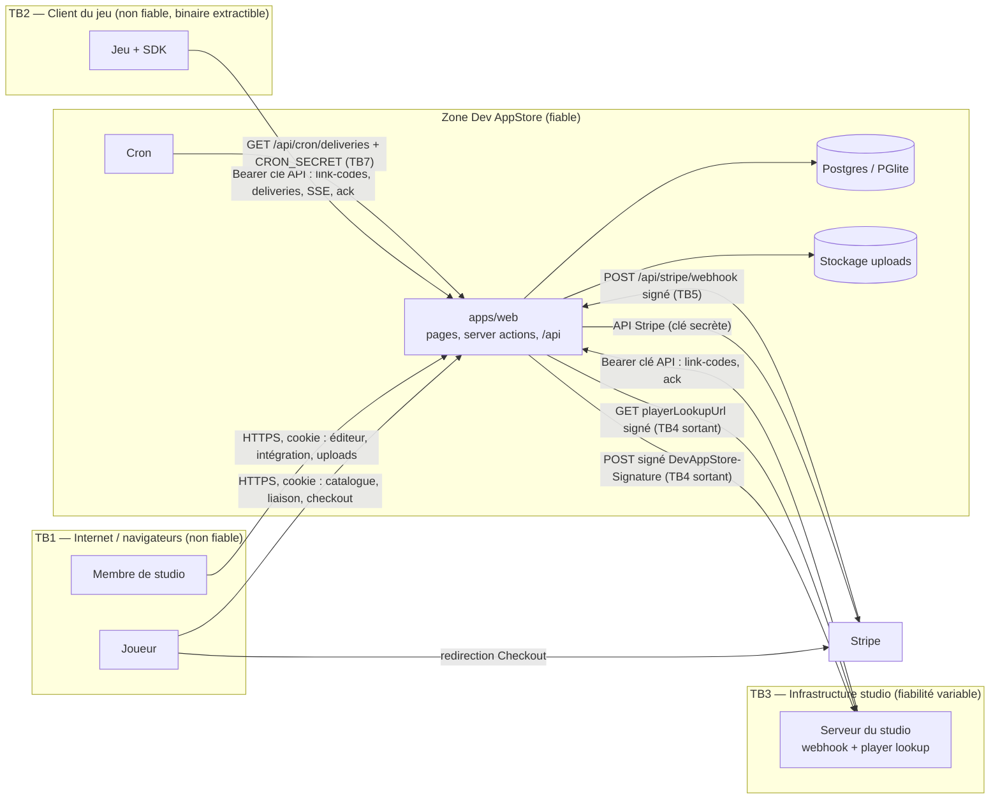

# Dev AppStore — modèle de menaces (STRIDE)

| | |
|---|---|
| Version | 1.0 (2026-11-09), état du dépôt après la « vague 0 » (commit `8d46ae1`) |
| Périmètre | `apps/web` (site joueur, espace studio, API `/api/v1`, webhooks Stripe, cron), `packages/core`, `packages/db`, SDK du jeu (`packages/sdk-js`, `sdks/unity`), endpoints exposés par les studios (`webhookUrl`, `playerLookupUrl`) |
| Sources lues | `ARCHITECTURE.md`, `apps/web/src/server/{session,api-key,links,delivery}.ts`, `packages/core/src/{crypto,delivery,constants,types,ids,money}.ts`, `packages/db/src/{index,seed}.ts`, `packages/db/src/schema/*.ts`, `apps/web/next.config.ts`, `apps/web/src/components/store/ItemCard.tsx`, `.env.example`, `.github/workflows/ci.yml` |
| Méthode | STRIDE par flux de données (S usurpation, T falsification, R répudiation, I divulgation, D déni de service, E élévation de privilèges), cotation Impact × Probabilité → priorité P0…P3 |
| Document associé | [`review-checklist.md`](./review-checklist.md) — checklist appliquée par la vague 2 (revue de sécurité) |

> Les routes et la plupart des fonctions décrites ici ne sont pas encore implémentées (vague 1 en cours). Ce document
> fixe donc surtout des **exigences** : la vague 2 vérifiera que le code livré les respecte. Les défauts déjà visibles
> dans les contrats existants sont regroupés en [section 7](#7-défauts-constatés-dans-les-contrats-existants).

---

## 1. Résumé exécutif

Dev AppStore manipule de l'argent (paiements Stripe Connect) et déclenche la création de biens virtuels dans des jeux tiers.
Les deux familles de risques dominantes sont donc **obtenir un objet sans payer** (fraude contre le studio) et **accéder
aux données ou à la configuration d'un autre studio** (rupture de l'isolation multi-tenant). Viennent ensuite la fraude
à la carte (le « cadeau » vers un ID joueur arbitraire est un vecteur de blanchiment), le SSRF via les URL configurées par
les studios et le XSS stocké via les uploads.

**Les 10 points les plus urgents** (détails dans les sections 6 et 7) :

| # | Point | Priorité |
|---|---|---|
| 1 | La session provisoire (`session.ts`) fait confiance à un cookie choisi par le client et connecte par défaut tout visiteur comme `usr_demo_player` : usurpation de n'importe quel utilisateur (D-01). | P0 |
| 2 | Le **mode simulation** de paiement s'active dès que `STRIPE_SECRET_KEY` est vide : en production, une variable manquante = objets gratuits pour tous (T-PAY-05). | P0 |
| 3 | Une **seule clé API par jeu**, utilisée à la fois par le serveur du studio et par le SDK embarqué dans le client du jeu : elle est extractible, et elle permet de lister / acquitter les livraisons de **n'importe quel joueur** et de créer des codes de liaison pour n'importe quel `player_id` (D-05). | P0 |
| 4 | `enqueueDelivery` ne vérifie pas que la commande est `paid` : tout appelant fautif livre une commande impayée (D-06). | P0 |
| 5 | Double canal webhook + SDK : une livraison `delivered` par webhook reste listée par le SDK (« delivered non ack. ») → **double crédit** si le jeu n'a pas un magasin d'idempotence commun (D-15). | P1 |
| 6 | SSRF via `playerLookupUrl` / `webhookUrl` (URL libres, `http://` accepté, `{player_id}` substitué tel quel) (T-LNK-05, T-DLV-08, D-23). | P1 |
| 7 | Requête de « player lookup » signée sur un corps vide : la signature ne lie ni l'URL ni le `player_id`, et la réponse n'est pas authentifiée (D-10). | P1 |
| 8 | Uploads : SVG servi sur l'origine principale = XSS stocké ; clé de fichier dérivée de l'utilisateur = traversée (T-UPL-01/02). | P0 dès que la route existe |
| 9 | Isolation multi-tenant : `requireGameAccess` sans rôle par défaut, IDOR sur les sous-ressources (articles, livraisons), server actions non revérifiées (T-MT-01…04). | P0 |
| 10 | Webhook Stripe : vérification de signature sur le corps brut, idempotence par événement / transition conditionnelle, contrôle du montant et de la devise (T-PAY-03/04). | P0 |

---

## 2. Description du système

### 2.1 Composants

| Composant | Rôle | Données sensibles |
|---|---|---|
| Navigateur joueur | Catalogue, liaison, achat, historique | cookie de session |
| Navigateur studio | Éditeur de boutique, intégration (clés, webhook), ventes, payouts | cookie de session, secret webhook affiché, clé API affichée une fois |
| `apps/web` (Next.js 15, App Router) | Pages, server actions, route handlers `/api/*` | tous les secrets serveur (`AUTH_SECRET`, `STRIPE_*`, `CRON_SECRET`, `DATABASE_URL`) |
| Base Postgres / PGlite (`packages/db`) | Utilisateurs, sessions, studios, jeux, articles, liaisons, codes, commandes, livraisons, journaux webhook | `games.webhookSecret` (en clair), `games.apiKeyHash`, `session.token`, `account.password` (haché par Better Auth), PII |
| Stockage des uploads | Icônes, bannières, visuels d'articles | contenu fourni par les studios |
| Stripe (Checkout + Connect) | Encaissement, commission `application_fee_amount`, reversement studio | — (aucune donnée carte ne transite par Dev AppStore) |
| Serveur du studio | Reçoit les webhooks `purchase.completed`, répond au « player lookup » | `webhookSecret`, clé API (serveur) |
| Client du jeu + SDK (`sdk-js`, Unity) | Écoute le flux SSE, interroge, crédite, `ack`, demande des codes de liaison | clé API **si** embarquée — à considérer comme publique |
| Cron (`/api/cron/deliveries`) | Relances webhook dues | `CRON_SECRET` |

### 2.2 Diagramme de flux de données et frontières de confiance

Frontières de confiance :

- **TB1** navigateur ↔ Dev AppStore : toute entrée (formulaires, server actions, query string, cookies, fichiers) est hostile.
- **TB2** client du jeu ↔ API v1 : tout ce qui est embarqué dans un binaire de jeu (clé API, logique de crédit) est connu
  de l'attaquant. **Le client du jeu n'est pas une frontière d'authentification.**
- **TB3** serveur du studio ↔ API v1 : authentifié par clé API ; le studio peut être compromis ou malveillant.
- **TB4** Dev AppStore → URL configurées par le studio (sortant) : zone de SSRF, de fuite de données et de réponses forgées.
- **TB5** Stripe → `/api/stripe/webhook` : authentifié par `STRIPE_WEBHOOK_SECRET`.
- **TB6** Dev AppStore ↔ base / stockage : réseau privé, identifiants en variables d'environnement.
- **TB7** ordonnanceur → cron : authentifié par `CRON_SECRET`.

---

## 3. Actifs

| ID | Actif | C | I | D | Commentaire |
|---|---|---|---|---|---|
| A1 | Fonds : paiements, commission plateforme, reversements Connect | | ●●● | ●● | Toute erreur = perte financière directe ou litige |
| A2 | Biens virtuels livrés (intégrité « payé ⇔ livré une fois ») | | ●●● | ●● | Cœur de la promesse aux studios |
| A3 | Clés API des jeux | ●●● | ●●● | | Accès à l'API v1 d'un jeu |
| A4 | Secrets webhook des jeux (`games.webhookSecret`) | ●●● | ●●● | | Permettent de forger des achats auprès du serveur du studio |
| A5 | Secrets plateforme (`AUTH_SECRET`, `STRIPE_SECRET_KEY`, `STRIPE_WEBHOOK_SECRET`, `CRON_SECRET`, `DATABASE_URL`) | ●●● | ●●● | | Compromission = compromission totale |
| A6 | Sessions et comptes utilisateurs (joueurs, membres de studio) | ●●● | ●●● | ● | |
| A7 | Liaisons compte Dev AppStore ↔ compte de jeu (`game_links`) et codes de liaison | ●● | ●●● | ● | Déterminent le destinataire des achats |
| A8 | Configuration des jeux (prix, articles, URL d'intégration, méthodes de liaison, statut) | | ●●● | ● | Un prix ou une URL modifiés = fraude ou détournement |
| A9 | Données de ventes d'un studio (chiffre d'affaires, joueurs) | ●●● | ●● | | Secret commercial ; isolation multi-tenant |
| A10 | PII joueurs : e-mail, `player_id`, nom de joueur, historique d'achats | ●●● | ● | | RGPD |
| A11 | Contenu servi par Dev AppStore (uploads, textes de boutique) | | ●●● | ● | Vecteur XSS / hameçonnage |
| A12 | Disponibilité de l'API v1, du flux SSE et du dispatcher de livraisons | | | ●●● | Un retard de livraison est perçu comme une non-livraison |

---

## 4. Acteurs de menace

| ID | Acteur | Capacités | Motivations |
|---|---|---|---|
| AC1 | **Joueur malveillant** | Compte Dev AppStore gratuit, navigateur, outils de rejeu (Burp), décompilation du client du jeu (clé API embarquée), scripts | Objets gratuits ou en double, cadeaux frauduleux, nuire à d'autres joueurs, revente |
| AC2 | **Fraudeur à la carte** | Cartes volées, nombreux comptes, automatisation | Convertir des cartes volées en biens revendables (« gift » vers un `player_id` client), rétrofacturations |
| AC3 | **Studio malveillant** | Compte studio légitime, contrôle total de ses URL d'intégration et de son contenu | Accéder aux données d'autres studios, SSRF vers l'infra Dev AppStore, XSS contre joueurs/staff, contourner la commission |
| AC4 | **Studio compromis** | Clé API, secret webhook ou compte d'un membre volés (phishing, fuite Git, CI) | Forger des livraisons, détourner les événements d'achat (changer `webhookUrl`), changer le compte de reversement |
| AC5 | **Membre de studio à rôle limité** (`developer`, `finance`) | Session valide, rôle restreint | Élévation de rôle (payouts, rotation de clés, suppression du jeu) |
| AC6 | **Attaquant réseau** | Position MITM (Wi-Fi public, DNS empoisonné, proxy d'entreprise), observation du trafic | Lire/modifier le trafic non chiffré (webhooks `http://`, lookup), voler des cookies, rejouer des requêtes signées |
| AC7 | **Attaquant anonyme Internet** | Scans, force brute, requêtes massives | Déni de service, énumération, exploitation de configuration par défaut (mode simulation, secrets d'exemple, seed de démo) |

Hors périmètre de cette version : compromission de Stripe, de l'hébergeur ou du poste d'un administrateur Dev AppStore ;
attaques physiques ; triche *dans* le jeu sans rapport avec Dev AppStore.

### Hypothèses

- H1 — En production, tout le trafic public est en HTTPS (HSTS) ; les secrets sont fournis par l'hébergeur, jamais committés.
- H2 — Better Auth remplacera la session provisoire avant toute exposition publique.
- H3 — Le serveur du studio vérifie la signature `DevAppStore-Signature` et dédoublonne sur `delivery_id` (à imposer par la doc et le SDK).
- H4 — Stripe Checkout héberge la saisie de carte : Dev AppStore reste hors du périmètre PCI-DSS SAQ-D (SAQ-A visé).

---

## 5. Cotation

- **Impact** : 3 = perte financière / compromission multi-tenant / prise de compte ; 2 = fraude limitée, fuite de PII d'un joueur, DoS partiel ; 1 = gêne, fuite mineure.
- **Probabilité** : 3 = exploitable par un joueur avec des outils standards ; 2 = demande un accès (compte studio, clé) ou des conditions ; 1 = théorique.
- **Priorité** : P0 (score ≥ 6 ou configuration par défaut dangereuse) = **bloquant avant toute mise en production** ;
  P1 (4–5) = avant ouverture publique ; P2 (2–3) = durcissement planifié ; P3 = phase 2+.

---

## 6. Menaces par flux

Légende des colonnes : **Existant** = mitigation déjà présente dans le code ou les contrats ; **À faire** = mitigation
exigée (vérifiée par la checklist). Les identifiants `CHK-…` renvoient à `review-checklist.md`.

### 6.1 Authentification et session (transverse)

| ID | STRIDE | Menace / scénario | Existant | À faire | Prio |
|---|---|---|---|---|---|
| T-AUTH-01 | S, E | Le cookie `devappstore_demo_user` est lu sans signature : n'importe qui fixe `usr_demo_dev` (ou tout autre ID) et devient cet utilisateur ; sans cookie, tout visiteur est `usr_demo_player`. | Aucun (stub vague 0) | Remplacer par Better Auth ; en attendant, refuser le stub si `NODE_ENV=production` (lever au démarrage). | P0 |
| T-AUTH-02 | S | Secret de session par défaut (`AUTH_SECRET=change-me` dans `.env.example`) reconduit en production → cookies forgeables. | — | Valider au démarrage : longueur ≥ 32 octets, ≠ valeurs d'exemple. | P0 |
| T-AUTH-03 | S | Force brute / bourrage d'identifiants sur `/login`, énumération de comptes via messages d'erreur ou `/signup`. | — | Limitation de débit Better Auth (`rateLimit`), message d'erreur générique, vérification d'e-mail obligatoire pour les comptes studio. | P1 |
| T-AUTH-04 | S, E | Prise de compte d'un membre de studio (phishing) → accès aux clés, URL, payouts. | — | 2FA (plugin Better Auth `twoFactor`) obligatoire pour `owner`/`admin`, ré-authentification pour les actions sensibles, notification e-mail sur changement d'intégration / payouts. | P1 |
| T-AUTH-05 | T | CSRF sur les route handlers authentifiés par cookie (`POST /api/checkout`, `POST /api/uploads`). | Server actions Next : contrôle d'`Origin` intégré | Cookie `SameSite=Lax`, `HttpOnly`, `Secure` ; vérifier `Origin`/`Host` sur chaque `POST` des route handlers ; `trustedOrigins` Better Auth. | P1 |
| T-AUTH-06 | S | Redirection ouverte via `?next=` (`requireUser(next)` → `/login?next=…`) : `next=//evil.tld` ou `/\evil.tld` après connexion → hameçonnage. | `encodeURIComponent` (encodage seulement) | N'accepter que des chemins relatifs commençant par un seul `/` et sans `\` ; sinon `/`. | P1 |
| T-AUTH-07 | I, E | Clickjacking de pages d'action (confirmation de liaison « Est-ce bien vous ? », achat, intégration). | — | `frame-ancestors 'none'` (CSP) / `X-Frame-Options: DENY`. | P1 |
| T-AUTH-08 | R | Absence de journal d'audit : impossible d'établir qui a changé un prix, une URL webhook ou un compte de reversement. | — | Table d'audit (acteur, studio, action, avant/après, IP) pour les actions studio sensibles. | P2 |

### 6.2 Liaison de compte (`code`, `id_confirm`)

Rappel : la liaison détermine **à quel `player_id` les achats d'un utilisateur Dev AppStore sont livrés**. Un achat lié au
mauvais joueur est soit un cadeau involontaire, soit un vecteur de fraude ; une liaison « vérifiée » (`verified=1`) à tort
est une fausse garantie dont pourront dépendre des fonctionnalités futures (OAuth, fidélité multi-jeux, remboursements).

| ID | STRIDE | Menace / scénario | Existant | À faire | Prio |
|---|---|---|---|---|---|
| T-LNK-01 | S | **Usurpation d'ID joueur (id_confirm)** : la méthode est déclarative ; un joueur saisit l'ID d'un tiers. Cas graves : (a) fraudeur à la carte qui « offre » des objets à des clients (blanchiment, rétrofacturations à la charge du studio/Dev AppStore) ; (b) arnaque « achète pour moi » où une victime est poussée à saisir l'ID de l'escroc. | `verified=0` stocké ; confirmation du nom affiché | Plafonds de montant et de vélocité pour les liaisons `verified=0` (par utilisateur, par `player_id` cible, par carte) ; Stripe Radar avec métadonnées (`game_id`, `player_id`, `link_method`) ; avertissement clair « les achats seront livrés à <nom> » ; le studio peut désactiver `id_confirm`. | P1 |
| T-LNK-02 | I | **Oracle d'énumération** : `id_confirm` renvoie `display_name`, `level`, `avatar_url` pour tout ID saisi → collecte de profils, vérification d'existence d'un compte. | — | Authentification requise, limitation de débit par utilisateur et par IP (ex. 10 lookups / heure), journalisation ; ne jamais exposer d'autres champs que ceux de `PlayerLookupResponse`. | P1 |
| T-LNK-03 | S | **Force brute des codes** : alphabet 32 symboles × 8 = 2⁴⁰ ≈ 1,1·10¹². Avec *A* codes actifs dans un jeu et *R* essais/s, gain espéré ≈ A·R·t / 2⁴⁰ : 10 000 codes actifs, 100 essais/s pendant 24 h → ≈ 8 % de chances de lier son compte au joueur d'un autre (et de consommer son code). | 40 bits d'entropie, CSPRNG (`randomInt`), TTL 10 min | Limitation stricte des essais de saisie (ex. 5 / 15 min par utilisateur, 20 / h par IP, global par jeu) ; recherche **par jeu** (`/games/[slug]/link`) ; réponse identique pour code inexistant / expiré / consommé ; alerte sur taux d'échec anormal. | P1 |
| T-LNK-04 | S | **Code créé pour un `player_id` arbitraire** : `POST /api/v1/link-codes` accepte `player_id` du corps. Si la clé API est embarquée dans le client du jeu (cf. D-05), un joueur génère un code pour la victime et obtient une liaison **marquée vérifiée** à son compte. | — | Distinguer clé **serveur** (secrète) et identité **client** ; pour un appel client, le `player_id` doit provenir d'un jeton de session joueur émis/signé par le serveur du studio, pas du corps ; à défaut, documenter que `code` n'est vérifié que si le studio appelle depuis son serveur. | P0 (avec D-05) |
| T-LNK-05 | I, E | **SSRF via `playerLookupUrl`** : URL libre configurée par le studio (`http://169.254.169.254/latest/meta-data/…`, `http://localhost:5432`, services internes, `file:`), déclenchée à volonté par n'importe quel joueur ; le `display_name` renvoyé est affiché → canal d'exfiltration ; DNS rebinding pour contourner une vérification faite à l'enregistrement. | — | Fonction sortante unique (`safeFetch`) : `https:` seulement en prod, résolution DNS puis blocage des plages privées/loopback/link-local/CGNAT/multicast/IPv6 ULA et des IPv4 mappées, connexion à l'IP résolue (anti-rebinding), `redirect: 'manual'`, timeout (≤ 5 s), taille de réponse plafonnée (≤ 16 Kio), en-têtes minimaux ; validation à l'enregistrement **et** à chaque appel ; liste blanche `localhost` uniquement en développement (seed `http://localhost:4100`). | P1 |
| T-LNK-06 | T | **Injection dans l'URL** : `{player_id}` remplacé sans encodage → `../admin`, `?x=`, `#`, `%2F` changent la cible de la requête signée. | — | Valider le format de `player_id` (ex. `^[A-Za-z0-9_.:-]{1,64}$`), puis `encodeURIComponent` ; n'autoriser `{player_id}` que dans le chemin ou une valeur de query. | P1 |
| T-LNK-07 | S, T | **Requête de lookup rejouable / réponse non authentifiée** : la signature d'un `GET` sans corps porte sur `${t}.` seulement (D-10) : une signature capturée vaut pour n'importe quel `player_id` pendant 300 s ; la réponse du studio n'est pas signée, un MITM (`http://`) peut substituer le nom affiché. | HMAC `signPayload` | Signer une chaîne canonique `GET\n<chemin+query>\n<t>` (ou passer `player_id` dans un corps `POST` signé) ; HTTPS obligatoire ; vérifier que `response.player_id === player_id demandé` ; valider la réponse par schéma zod (longueurs, `avatar_url` en `https:`). | P1 |
| T-LNK-08 | T | **Course sur la consommation du code** : deux soumissions simultanées du même code créent deux liaisons. | — | Consommation atomique : `UPDATE link_codes SET consumed_at=now() WHERE game_id=$1 AND code=$2 AND consumed_at IS NULL AND expires_at>now() RETURNING …` dans la même transaction que l'insertion de `game_links`. | P1 |
| T-LNK-09 | I | Codes affichés en stream / capture d'écran : un spectateur saisit le code avant le joueur. | TTL 10 min | Notifier le jeu de la liaison (événement `link.created` ou statut dans l'API) pour affichage « Lié à j\*\*\*@… » et permettre la déliaison côté joueur ; invalider les codes précédents d'un même joueur à chaque nouvelle demande. | P2 |
| T-LNK-10 | D | Inondation de `link-codes` par un client (clé publique) → croissance de la table, collisions sur l'unicité `(game_id, code)` conservée à vie (D-13). | Unicité `(game_id, code)` | Plafond de codes actifs par `player_id`, limitation de débit par clé, purge des codes expirés, réessai sur violation d'unicité. | P2 |
| T-LNK-11 | T | Relier à nouveau son compte à un autre `player_id` entre le checkout et la livraison pour détourner un achat. | `orders.playerId` figé à la création de la commande | Conserver ce gel ; la livraison doit lire `orders.playerId`, jamais `game_links`. | P2 (à vérifier) |

### 6.3 Paiement (checkout, Stripe, mode simulation)

| ID | STRIDE | Menace / scénario | Existant | À faire | Prio |
|---|---|---|---|---|---|
| T-PAY-01 | T | **Manipulation de prix** : le client envoie un prix, une devise, une quantité ou un `gameId` différent de l'article. | Contrat `POST /api/checkout { itemId }` (aucun prix côté client) ; montants entiers en centimes | Montant, devise, `productId`, `gameId` lus **en base** depuis `itemId` ; refuser si `item.active=false`, `game.status≠'live'`, studio sans `stripeChargesEnabled` ; rejeter toute clé supplémentaire (zod `.strict()`) ; quantité d'achat fixée à 1 tant que le multi-quantité n'est pas spécifié (cf. D-09). | P0 |
| T-PAY-02 | T | **Prix aberrant configuré par le studio** (0, négatif, non entier, hors paliers) ou modifié entre l'affichage et le paiement. | `PRICE_TIERS_CENTS` (constante) | Validation zod côté serveur (entier, ∈ `PRICE_TIERS_CENTS` ou bornes), prix figé dans la commande et dans la session Stripe ; afficher le montant final dans Checkout. | P1 |
| T-PAY-03 | S, T | **Webhook Stripe forgé** : un attaquant POST `checkout.session.completed` sur `/api/stripe/webhook` pour marquer une commande payée. | `STRIPE_WEBHOOK_SECRET` prévu | `stripe.webhooks.constructEvent(rawBody, sig, secret)` sur **le corps brut** (`await req.text()`), jamais sur un JSON re-sérialisé ; refuser si le secret est vide ; route exclue de tout middleware qui lit le corps. | P0 |
| T-PAY-04 | T, R | **Rejeu / doublon / désordre des webhooks Stripe** : Stripe réessaie et peut livrer en double ou dans le désordre ; un rejeu (signature valide dans la tolérance de 300 s) ne doit pas créer deux livraisons. | Unicité `deliveries.orderId` ; `enqueueDelivery` idempotent (partiellement, D-07) | Transition conditionnelle `UPDATE orders SET status='paid' … WHERE id=$1 AND status='pending' RETURNING` ; ne déclencher `enqueueDelivery` que si une ligne est modifiée ; trouver la commande par `stripeCheckoutSessionId` (pas par une métadonnée libre) ; vérifier `payment_status==='paid'`, `amount_total` et `currency` égaux à la commande ; gérer `checkout.session.async_payment_succeeded/failed` ; optionnel : table des `event.id` traités. | P0 |
| T-PAY-05 | E | **Mode simulation en production** : `STRIPE_SECRET_KEY` vide ⇒ `/checkout/mock` marque les commandes payées sans paiement. Une variable oubliée lors d'un déploiement = boutique gratuite. Variante : clé `sk_test_` en production ⇒ paiements avec cartes de test. | — | Mode simulation **impossible** si `NODE_ENV=production` (échec au démarrage si `STRIPE_SECRET_KEY` absente) ; exiger `sk_live_` en production (ou un drapeau explicite pour la préproduction) ; `/checkout/mock` vérifie côté serveur que le mode est actif, que la commande appartient à l'utilisateur et est `pending` ; bannière visible « mode simulation ». | P0 |
| T-PAY-06 | T | **Confirmation par la page de succès** : `/checkout/success?session_id=…` marque la commande payée sur la foi de l'URL. | — | La page de succès est en lecture seule (ou relit la session via l'API Stripe et vérifie `payment_status`) ; seule la transition conditionnelle déclenche la livraison. | P0 |
| T-PAY-07 | T | **Commission contournée** : `application_fee_amount` calculé à partir d'un `PLATFORM_FEE_BPS` invalide (`NaN`, négatif, `0` par erreur) ou d'un montant client. | `feeCents()` (arrondi) | Parser et borner `PLATFORM_FEE_BPS` au démarrage (entier 0–3000) ; calcul serveur sur `amountCents` de la commande ; stocker `platformFeeCents` et le comparer au `application_fee` Stripe en rapprochement. | P1 |
| T-PAY-08 | E, T | **Détournement du compte de reversement** : modification de `studios.stripeAccountId` (formulaire, server action, injection de champ) par un rôle non `owner` ou un autre studio. | — | `stripeAccountId` écrit uniquement par le flux d'onboarding Connect (compte créé par Dev AppStore), jamais depuis une entrée utilisateur ; rôle `owner` + ré-authentification ; webhook `account.updated` pour `stripeChargesEnabled`. | P1 |
| T-PAY-09 | T | **URL de retour Checkout construites depuis l'en-tête `Host`** (injection d'hôte → `success_url` vers un domaine tiers). | `APP_URL` dans `.env.example` | `success_url`/`cancel_url` dérivées de `APP_URL` uniquement. | P1 |
| T-PAY-10 | R, T | **Rétrofacturation / remboursement après livraison** : le joueur conteste le paiement et garde l'objet. | Type `purchase.refunded` déclaré, sans flux | Écouter `charge.refunded`, `charge.dispute.created` ; passer la commande à `refunded` ; émettre `purchase.refunded` signé au studio (révocation) ; vélocité / Radar. | P2 (phase 2) |
| T-PAY-11 | I | Fuite de détails Stripe (ID de session, e-mail) dans les logs ou les réponses d'erreur. | — | Réponses d'erreur génériques ; pas de log des corps de webhook complets. | P2 |

### 6.4 Livraison (webhook sortant, SDK/SSE, ack, cron)

| ID | STRIDE | Menace / scénario | Existant | À faire | Prio |
|---|---|---|---|---|---|
| T-DLV-01 | S, T | **Falsification de webhooks auprès du studio** : un attaquant POST un faux `purchase.completed` sur `webhookUrl` (URL souvent devinable) pour obtenir un objet gratuit. | HMAC-SHA256 `t=…,v1=…` sur `${t}.${body}`, comparaison à temps constant, tolérance 300 s | Le SDK fournit `verifyWebhook(rawBody, header, secret)` et la documentation impose la vérification sur le corps brut ; la page Intégration propose « envoyer un événement de test **mal signé** » et alerte si le serveur répond 2xx. | P1 |
| T-DLV-02 | T | **Rejeu d'un webhook capturé** dans la fenêtre de 300 s (MITM sur `http://`, logs du studio, proxy). | Horodatage signé | Idempotence côté studio sur `delivery_id` (persistée), documentée comme **obligatoire** ; HTTPS obligatoire pour `webhookUrl` en production. | P1 |
| T-DLV-03 | T | **Double crédit** : (a) le studio crédite puis répond en retard/non-2xx → relance ; (b) webhook `delivered` **et** SDK qui liste les livraisons « delivered non ack. » (D-15) ; (c) deux exécutions concurrentes du cron ou du dispatcher envoient la même livraison ; (d) course dans `enqueueDelivery` (D-07). | `delivery_id`/`order_id` annoncés comme clés d'idempotence ; unicité `deliveries.orderId` | Clé d'idempotence unique par achat, identique sur tous les canaux ; préciser par jeu le canal qui crédite (webhook **ou** SDK) ou exiger un magasin d'idempotence partagé ; réservation atomique des livraisons dues (`UPDATE … SET next_attempt_at=now()+lease WHERE id=$1 AND next_attempt_at<=now() RETURNING`, ou `FOR UPDATE SKIP LOCKED`) ; le SDK persiste les `delivery_id` crédités. | P1 |
| T-DLV-04 | S, E | **Fuite de clé API** (binaire du jeu, dépôt Git, logs, query string) : l'attaquant liste les livraisons de **tous** les joueurs, ouvre leur flux SSE, **acquitte** leurs livraisons (le vrai client ne les reçoit plus → non-livraison), crée des codes de liaison. | Seule l'empreinte SHA-256 est stockée ; préfixe affiché | Deux types de clés (cf. D-05) : `sk_`/secrète (serveur, toutes opérations) et identité client limitée au joueur (jeton signé par le serveur du studio, ou au minimum : client limité à `GET` sur **son** `player_id`, `ack` interdit) ; plusieurs clés actives par jeu (rotation sans interruption), `last_used_at`, révocation ; préfixe distinctif `das_live_` / `das_test_` déclaré au secret scanning GitHub ; jamais de clé dans une URL. | P0 |
| T-DLV-05 | I | **SSE** : `GET /api/v1/deliveries/stream?player_id=` — fuite inter-joueurs ou inter-jeux si le filtre n'est pas `(game_id de la clé, player_id)` ; tentation de passer la clé en query string pour `EventSource` navigateur (journalisée par les proxys). | — | Filtre strict `game_id = jeu authentifié AND player_id = demandé` ; `player_id` obligatoire ; clé uniquement en en-tête (le SDK utilise `fetch` + lecture de flux) ; pas de `Access-Control-Allow-Origin` reflété avec credentials. | P1 |
| T-DLV-06 | D | **Épuisement par connexions SSE** (une clé publique → milliers de flux), limites de durée des fonctions serverless, absence de heartbeat. | — | Plafond de connexions par clé et par `player_id`, heartbeat (commentaire `:` toutes les 15–25 s), fermeture après N minutes avec reconnexion client (`retry:`), `Last-Event-ID` ; repli sur interrogation. | P2 |
| T-DLV-07 | T, E | **Ack forgé ou inter-jeux** : `POST /api/v1/deliveries/{id}/ack` sur une livraison d'un autre jeu (IDs prédictibles ou fuités). | IDs aléatoires 96 bits (`newId`) | `WHERE id=$1 AND game_id=<jeu authentifié>` ; transition via `canTransition` ; réponse 404 identique pour « inexistant » et « autre jeu ». | P0 |
| T-DLV-08 | I, E | **SSRF via `webhookUrl`** : mêmes vecteurs que T-LNK-05, déclenchés par chaque achat et chaque relance ; le journal d'intégration (`webhook_attempts.error`, code HTTP, durée) sert d'oracle de scan de ports internes. | — | `safeFetch` commun (cf. T-LNK-05) ; ne stocker ni n'afficher le corps de réponse au-delà de quelques centaines d'octets échappés ; messages d'erreur normalisés (« connexion refusée », « timeout ») sans détail réseau interne. | P1 |
| T-DLV-09 | I | **Fuite du secret webhook** : affiché à tout membre (y compris `finance`), stocké en clair, pas de rotation ; un studio compromis ou un dump de base permet de forger des achats auprès de *tous* les studios. | Secret par jeu | Affichage réservé `owner/admin/developer` ; rotation avec période de double signature (`v1=` multiples dans l'en-tête, D-11) ; chiffrement applicatif au repos (clé maître hors base) ; jamais renvoyé par une API ni sérialisé vers le client. | P1 |
| T-DLV-10 | T | **Détournement des événements** : un studio compromis change `webhookUrl` vers un serveur tiers → récupère `player_id`, montants. | — | Changement d'URL réservé `owner/admin`, ré-authentification, notification e-mail, journal d'audit. | P2 |
| T-DLV-11 | D | **Cron** : `/api/cron/deliveries` appelé sans secret (ex. `Bearer undefined` accepté si `CRON_SECRET` absent), ou en boucle → envois massifs. | `CRON_SECRET` prévu (absent de `.env.example`) | Refuser si `CRON_SECRET` vide ; comparaison à temps constant ; traitement par lots bornés ; idempotent. | P1 |
| T-DLV-12 | D | **Amplification** : un studio dont l'URL est lente immobilise le dispatcher (timeouts longs, relances illimitées). | Planning de relances borné (`WEBHOOK_RETRY_SCHEDULE_MS`, 7 essais) | Timeout ≤ 10 s, envois concurrents bornés par jeu, coupe-circuit par jeu. | P2 |
| T-DLV-13 | R | Litige « non livré » sans preuve. | Table `webhook_attempts` | Conserver `delivered_at`, `acknowledged_at`, tentatives (URL sans query string sensible, statut, durée) ; visible du studio et du support. | P2 |

### 6.5 Uploads et contenu fourni par les studios

| ID | STRIDE | Menace / scénario | Existant | À faire | Prio |
|---|---|---|---|---|---|
| T-UPL-01 | T, E | **SVG / HTML → XSS stocké** : un studio téléverse un SVG avec `<script>` ou `onload`, servi par `GET /api/uploads/…` sur l'origine Dev AppStore ; ouvert directement, il s'exécute avec les cookies de l'utilisateur (joueur ou membre d'un autre studio). Idem pour un fichier HTML déguisé (`.png` avec contenu HTML et sniffing). | — | Liste blanche PNG/JPEG/WebP (+ GIF éventuel) vérifiée par **octets magiques** (sharp `metadata()`), refus du SVG, **ré-encodage** systématique via sharp (supprime EXIF et charges utiles) ; servir avec `Content-Type` forcé, `X-Content-Type-Options: nosniff`, `Content-Security-Policy: default-src 'none'; sandbox`, `Content-Disposition: inline; filename="…"` ; idéalement domaine distinct sans cookies. | P0 |
| T-UPL-02 | T, I | **Traversée de chemin** : `GET /api/uploads/[...key]` avec `..`, `%2e%2e`, `%2f`, `\`, octets nuls, chemin absolu → lecture de `.env`, `.data/pglite`, code source ; `POST` qui écrit hors du dossier si le nom de fichier client est utilisé. | — | Clés générées par le serveur (`newId` + extension déduite du type réel), jamais du nom client ; regex stricte sur la clé en lecture (ex. `^[a-z]{3}_[A-Za-z0-9_-]{16}\.(png|jpe?g|webp)$`) ; `path.resolve` puis vérification du préfixe du dossier racine. | P0 |
| T-UPL-03 | D | **Bombe de décompression / fichiers énormes** (image 50 000 × 50 000, PNG compressé) → mémoire saturée. | — | Taille max (ex. 5 Mo) vérifiée avant lecture complète ; sharp `limitInputPixels` ; dimensions max ; quotas par studio. | P1 |
| T-UPL-04 | E | **Upload anonyme / hors studio** : n'importe qui stocke des fichiers (hébergement gratuit de contenu illicite). | — | Authentification + appartenance à un studio ; rattachement de chaque fichier au studio ; limitation de débit. | P1 |
| T-UPL-05 | I | **URL d'images externes** (`iconUrl`, `bannerUrl`, `models[].imageUrl`, `avatar_url` du lookup) pointant vers un serveur tiers → pistage de l'IP des joueurs, contenu changeant après modération, contenu mixte. | Champs texte libres | N'accepter que les URL de l'origine des uploads Dev AppStore (ou des `data:` produits par le seed en dev) ; `avatar_url` proxifiée ou ignorée ; CSP `img-src 'self'`. | P2 |
| T-UPL-06 | T | **Injection CSS via le style des cartes** : `ItemStyle.bg1/bg2/borderColor/priceBg…` et `GameTheme.gradient.c1/c2` sont interpolés dans `background` (`cardBackground`) ; une valeur `red, url(https://pistage.tld/x)` déclenche une requête depuis le navigateur du joueur. React empêche l'évasion du style, pas `url()`. | — | Valider toutes les couleurs par zod (`^#[0-9a-fA-F]{6}$` ou `transparent`), nombres bornés (`GRID_LIMITS`, `borderWidth`) ; CSP `img-src` restrictive en défense en profondeur. | P2 |
| T-UPL-07 | T | **XSS via textes de boutique** (titre, sous-titre, description, nom du studio, `display_name` du lookup) si rendus avec `dangerouslySetInnerHTML` ou dans un contexte non échappé (attribut `href`, JSON-LD, métadonnées). | Échappement React par défaut | Interdire `dangerouslySetInnerHTML` sur du contenu studio/joueur ; `href` limités à `https:` ; JSON-LD sérialisé avec échappement de `<`. | P1 |
| T-UPL-08 | S | **Usurpation d'un jeu ou d'un studio connu** (faux « Crystal Clash ») pour encaisser des joueurs. | Statuts `draft/review/live/suspended` | Seuls les jeux `live` sont visibles/achetables ; passage `review → live` par Dev AppStore (modération) ; `slug` réservés. | P2 |

### 6.6 Multi-tenant et autorisation studio

| ID | STRIDE | Menace / scénario | Existant | À faire | Prio |
|---|---|---|---|---|---|
| T-MT-01 | E, I | **IDOR sur le jeu** : un membre du studio A ouvre `/studio/games/<id du studio B>` ou appelle une server action avec ce `gameId`. | `requireGameAccess(gameId)` (jointure `studio_members`) | Chaque page **et chaque server action / route handler** studio appelle `requireGameAccess` avec le `gameId` de la ressource, côté serveur, à chaque requête (une server action est un endpoint public). | P0 |
| T-MT-02 | E, I | **IDOR sur les sous-ressources** : action `updateItem(itemId, …)` qui vérifie l'accès à `gameId` (paramètre de l'URL) mais modifie `itemId` d'un autre jeu ; idem pour livraisons (relance manuelle), commandes, uploads. | — | Toujours requêter `WHERE items.id=$itemId AND items.game_id=$gameId` (ou dériver `gameId` depuis la ressource puis vérifier l'accès) ; tests d'accès croisé. | P0 |
| T-MT-03 | E | **Rôles non appliqués** : `requireGameAccess(gameId)` sans `roles` autorise `finance` et `developer` à tout faire (rotation de clé, URL webhook, payouts, suppression). | Paramètre `roles?` optionnel | Matrice de rôles (ci-dessous) appliquée explicitement ; envisager un `roles` obligatoire. | P1 |
| T-MT-04 | I | **Fuite inter-studios dans les requêtes agrégées** (ventes, tendances, recherche, journaux) : oubli du filtre `game_id`/`studio_id`. | — | Toute requête analytique filtre par `game_id` obtenu après `requireGameAccess` ; aucune entrée client n'entre dans un `sql` brut. | P0 |
| T-MT-05 | E | **Mass assignment** : une server action passe l'objet du formulaire à `db.update(games).set(input)` → modification de `studioId`, `status` (`live` sans revue), `apiKeyHash`, `webhookSecret`. | — | Schéma zod `.strict()` avec liste blanche de champs par action ; champs sensibles jamais issus d'une entrée. | P0 |
| T-MT-06 | I | **Sur-exposition côté client** : une ligne `games` complète (avec `webhookSecret`, `apiKeyHash`) passée en prop à un composant client, renvoyée par `authenticateGame` puis sérialisée, ou incluse dans la page publique `/games/[slug]`. | — | Projections explicites (DTO) pour tout ce qui part vers le client ; `import 'server-only'` sur les modules de données ; test : le HTML de `/games/[slug]` ne contient aucun `whsec_`. | P1 |
| T-MT-07 | E | **Énumération** : messages distincts 403/404 révèlent l'existence d'IDs d'autres studios. | — | Répondre 404 (`notFound()`) quand l'accès est refusé à une ressource d'un autre studio. | P3 |

Matrice de rôles proposée (à valider par la tâche « auth ») :

| Action | owner | admin | developer | finance |
|---|---|---|---|---|
| Éditer la boutique (articles, thème, uploads) | ✓ | ✓ | ✓ | |
| Voir la clé API (préfixe) / créer, révoquer une clé | ✓ | ✓ | ✓ (création) | |
| Voir / faire tourner le secret webhook, changer `webhookUrl` / `playerLookupUrl` / `linkMethods` | ✓ | ✓ | ✓ (sauf rotation) | |
| Soumettre en revue / suspendre un jeu | ✓ | ✓ | | |
| Ventes et tendances | ✓ | ✓ | | ✓ |
| Payouts / onboarding Stripe Connect | ✓ | | | ✓ (lecture) |
| Gérer les membres et rôles | ✓ | ✓ (sauf owner) | | |

### 6.7 Plateforme, configuration et chaîne d'approvisionnement

| ID | STRIDE | Menace / scénario | Existant | À faire | Prio |
|---|---|---|---|---|---|
| T-PLT-01 | T, D | **Base embarquée silencieuse en production** : `DATABASE_URL` absente ⇒ PGlite dans `.data/pglite` (éphémère en serverless, non partagée entre instances) → perte de commandes, livraisons dupliquées. | — | Échec au démarrage si `NODE_ENV=production` et `DATABASE_URL` vide. | P1 |
| T-PLT-02 | S, E | **Données de démo en production** : `DEMO_KEYS` committées (`das_test_demo_crystal_clash`, `whsec_demo_crystal_clash`), utilisateurs `usr_demo_*` connus. | — | `db:seed` refuse de s'exécuter si `NODE_ENV=production` ou si `DATABASE_URL` ne désigne pas une base locale ; aucune clé `das_test_demo*` acceptée en production. | P1 |
| T-PLT-03 | T, I | **En-têtes de sécurité absents** (`next.config.ts` n'en définit aucun) : pas de CSP, HSTS, `frame-ancestors`, `Referrer-Policy`, `Permissions-Policy`. | — | `headers()` dans `next.config.ts` ; CSP avec nonce pour les scripts, `img-src 'self' data:` (+ origine des uploads), `connect-src 'self' https://api.stripe.com`, `form-action 'self' https://checkout.stripe.com`. | P1 |
| T-PLT-04 | I | **Secrets dans les logs / erreurs** : en-tête `Authorization`, corps de webhook, URL avec query string, piles d'erreurs renvoyées au client. | — | Masquage des en-têtes sensibles ; `apiError` ne renvoie jamais de message d'exception brut ; `NODE_ENV=production` (pas de stack). | P2 |
| T-PLT-05 | T | **Chaîne d'approvisionnement** : dépendances compromises, workflow CI avec permissions par défaut du `GITHUB_TOKEN`. | `npm ci` avec lockfile | `permissions: contents: read` dans `ci.yml`, `npm audit --omit=dev` (non bloquant au début), Dependabot, secret scanning + push protection. | P3 |
| T-PLT-06 | D | **Absence de limitation de débit globale** sur `/api/v1/*`, `/api/checkout`, `/login`, liaison. | — | Limiteur (clé + IP + utilisateur) partagé, stockage en base ou Redis ; réponses `429` avec `Retry-After`. | P1 |
| T-PLT-07 | I | **RGPD** : PII joueurs (`player_id`, nom, e-mail, historique) envoyées aux studios et conservées sans durée. | — | Minimisation (le webhook n'envoie pas l'e-mail), durées de conservation, suppression de compte en cascade (déjà `onDelete: cascade` sur `game_links`), registre des traitements. | P2 |

---

## 7. Défauts constatés dans les contrats existants

Constatés à la lecture du code au commit `8d46ae1`. Aucun code n'a été modifié par cette tâche ; chaque défaut est
attribué à la tâche propriétaire.

| ID | Fichier:ligne | Défaut | Conséquence | Recommandation | Propriétaire | Prio |
|---|---|---|---|---|---|---|
| D-01 | `apps/web/src/server/session.ts:21` | Identité lue dans un cookie non signé `devappstore_demo_user` ; valeur par défaut `usr_demo_player` si absent. | Usurpation de tout utilisateur (dont un `owner` de studio) ; tout visiteur anonyme est « connecté ». | Remplacer par Better Auth ; garde-fou immédiat : `if (process.env.NODE_ENV === 'production') throw` dans le stub. | auth | P0 |
| D-02 | `apps/web/src/server/session.ts:46` | `throw new Error('FORBIDDEN')` générique ; `roles` optionnel. | Dans un route handler → **500** au lieu de 403/404 ; message d'erreur potentiellement renvoyé ; sans `roles`, tous les rôles passent (T-MT-03). | Classe d'erreur typée (`ForbiddenError`) + helper qui mappe vers 404/403 ; rôles explicites pour les actions sensibles. | auth | P1 |
| D-03 | `apps/web/src/server/session.ts:40` | `requireGameAccess` appelle `requireUser` qui fait un `redirect()`. | Utilisé dans un route handler d'API, renvoie une redirection HTML au lieu d'un 401 ; facile à confondre. | Variante `requireGameAccessApi` qui renvoie 401/404 JSON. | auth | P2 |
| D-04 | `apps/web/src/server/api-key.ts:13` | `authenticateGame` ne vérifie pas `games.status` et renvoie la ligne complète (dont `webhookSecret`, `apiKeyHash`). | Un jeu `suspended` continue d'utiliser l'API ; risque de sérialiser le secret dans une réponse (T-MT-06). | Refuser `suspended` (et éventuellement `draft` pour les clés live) ; ne sélectionner que les colonnes utiles ou renvoyer un objet restreint. | delivery | P1 |
| D-05 | `apps/web/src/server/api-key.ts` + `games.apiKeyHash` (schéma) | Une seule clé par jeu, sans portée, sans rotation, partagée entre serveur du studio et SDK client (« L'API `/api/v1` s'authentifie par `Bearer <clé API du jeu>` » pour le serveur **et** le SDK). | Une clé extraite d'un client Unity/JS permet `ack`, listing et SSE pour **tout** `player_id`, et la création de codes de liaison pour tout joueur (T-DLV-04, T-LNK-04). | Table `api_keys` (plusieurs clés, `kind: 'secret'|'client'`, `last_used_at`, `revoked_at`) ; pour le client, jeton joueur signé par le serveur du studio ou portée limitée (lecture de son `player_id`, pas d'`ack` sur autre joueur, pas de `link-codes` sans `player_id` signé). À défaut à court terme : documenter que la clé ne doit **jamais** être embarquée dans un client et que le SDK client passe par le serveur du studio. | delivery + linking + sdk | P0 |
| D-06 | `apps/web/src/server/delivery.ts:13` | `enqueueDelivery` ne vérifie pas `order.status === 'paid'`. | Tout appel prématuré (page de succès, `/checkout/mock` mal protégé, bug) livre un objet impayé. | `if (order.status !== 'paid') throw` (invariant du contrat). | delivery | P0 |
| D-07 | `apps/web/src/server/delivery.ts:11-33` | Lecture puis insertion non atomiques, hors transaction ; en cas de course, `onConflictDoNothing` ignore l'insertion mais la fonction **dispatch et renvoie un `id` qui n'existe pas**. | Identifiant de livraison erroné renvoyé à « payments » ; double traitement possible si `dispatchDelivery` est ensuite rendu non idempotent. | `insert … onConflictDoNothing().returning()` puis, si vide, relire par `orderId` ; transaction ; `dispatchDelivery` idempotent (réservation atomique). | delivery | P1 |
| D-08 | `apps/web/src/server/delivery.ts:17,26` | `item_type` lu sur l'article **actuel** (modifiable, supprimable) avec repli silencieux `'consumable'`. | Un article `non_consumable` supprimé ou modifié après l'achat est livré comme consommable (crédit répété possible côté jeu). | Figer `itemType` dans `orders` à la création (comme `productId`) ; ne pas replier silencieusement. | payments + delivery | P2 |
| D-09 | `types.ts` (`PurchaseEvent.quantity`) / `orders.quantity` / `items.quantity` | Ambiguïté : `items.quantity` = taille du lot (1 200 gemmes) alors que `orders.quantity` (défaut 1) est recopié dans `PurchaseEvent.quantity`. | Selon l'implémentation de « payments », le jeu crédite 1 au lieu de 1 200, ou 1 200 × nombre d'unités sans que le prix ait été multiplié. | Spécifier : `quantity` = nombre d'unités achetées (toujours 1 en phase 1) et ajouter `bundle_size` / s'appuyer sur `product_id` côté jeu ; prix Stripe = `priceCents × quantity`. | payments + core | P1 |
| D-10 | `packages/core/src/crypto.ts:7` + flux `id_confirm` | `signPayload(body, …)` ne signe que `${t}.${body}`. Pour le lookup (requête `GET`, `{player_id}` dans l'URL), le corps est vide : la signature ne lie ni la méthode, ni l'URL, ni le `player_id` ; la réponse n'est pas authentifiée. | Une signature capturée est valide pour n'importe quel joueur pendant 300 s ; un MITM peut altérer le nom affiché (T-LNK-07). | Ajouter (en fin de fichier) `signRequest(method, pathAndQuery, body, secret, t)` sur une chaîne canonique, ou faire du lookup un `POST` JSON `{ player_id }` signé ; HTTPS obligatoire ; contrôler `response.player_id`. | core (via linking) | P1 |
| D-11 | `packages/core/src/crypto.ts:14` | Analyse d'en-tête : une seule valeur `v1` retenue (la dernière), espaces non tolérés. | Rotation de secret impossible sans coupure (pas de double signature `v1=…,v1=…`). | Accepter plusieurs `v1`, `trim()` des parties ; comparer chacune à temps constant. | core | P2 |
| D-12 | `packages/core/src/crypto.ts:5,16` | Tolérance symétrique ±300 s, aucune protection anti-rejeu côté récepteur. | Rejeu possible pendant 5 min si le studio ne dédoublonne pas (T-DLV-02). | Documenter l'idempotence obligatoire ; le `verifyWebhook` du SDK doit renvoyer `delivery_id` pour faciliter le dédoublonnage. | sdk + docs | P2 |
| D-13 | `packages/db/src/schema/commerce.ts` (`link_codes_game_code_uq`) + `crypto.ts:34` | Unicité `(game_id, code)` conservée pour les codes expirés/consommés ; `generateLinkCode` n'a pas de réessai. Espérance de première collision ≈ 1,3 M de codes générés pour un même jeu (anniversaire sur 2⁴⁰), puis probabilité croissante d'échec d'insertion. | Erreurs 500 aléatoires sur `POST /api/v1/link-codes` pour les gros jeux. | Réessai sur violation d'unicité ; purge des codes expirés (cron) ; ou unicité partielle sur les codes non consommés. | linking | P2 |
| D-14 | `packages/core/src/delivery.ts:16` | `nextAttemptAt(0)` lit l'index −1 → `null` (= abandon). `purchase.refunded` est typé sans statut ni transition. | Un appelant qui passe le nombre d'essais *avant* incrément marque la livraison `failed` dès le premier échec ; pas de chemin de révocation. | Documenter « `attempts` = nombre d'essais déjà effectués, ≥ 1 » ou gérer 0 ; spécifier le flux de remboursement (phase 2). | core / delivery | P2 |
| D-15 | `ARCHITECTURE.md` (flux 3) | Le webhook passe la livraison à `delivered` ; le SDK liste « pending + delivered non ack. ». Un jeu qui active les deux canaux reçoit le même achat deux fois. | Double crédit si le jeu n'a pas un magasin d'idempotence commun aux deux canaux (T-DLV-03). | Choisir un canal créditeur par jeu (`deliveryMode: 'webhook'|'sdk'|'both'`) ou, pour `both`, imposer que le serveur du studio `ack` après crédit et que le SDK ne liste que les livraisons non `delivered` ; documenter `delivery_id` comme clé unique tous canaux. | delivery + sdk | P1 |
| D-16 | `games.webhookSecret` (schéma), `.env.example`, `seed.ts:7-9` | Secret webhook stocké en clair ; `AUTH_SECRET=change-me` par défaut ; `CRON_SECRET` absent de `.env.example` ; clés de démo committées. | Dump de base = forge d'achats pour tous les studios ; secrets par défaut reconduits ; cron non protégé si la variable manque (T-DLV-11). | Chiffrement applicatif au repos ; validation des variables d'environnement au démarrage (zod) ; ajouter `CRON_SECRET` à `.env.example` ; seed bloqué en production. | db + auth + delivery | P1 |
| D-17 | `packages/db/src/index.ts:31-36` | Repli silencieux sur PGlite si `DATABASE_URL` est vide. | En production : base éphémère et non partagée (T-PLT-01). | Échec explicite en production. | db | P1 |
| D-18 | `apps/web/src/components/store/ItemCard.tsx:27-30,67-68,84` | Valeurs de style interpolées dans `background`/`border` et `imageUrl` rendu tel quel. | Injection `url(…)` / images tierces pour pister les joueurs si les entrées ne sont pas validées (T-UPL-05/06). | Validation zod stricte à l'écriture (éditeur studio) ; CSP `img-src`. | studio-editor | P2 |
| D-19 | `game_links` (schéma) | Pas d'unicité `(game_id, player_id)` : plusieurs comptes Dev AppStore peuvent se lier au même joueur, y compris en `verified=0`. | Facilite T-LNK-01 (nombreux comptes « offrant » au même joueur) ; ambiguïté pour les futures fonctionnalités (OAuth, fidélité). | Décision produit explicite ; au minimum, vélocité par `player_id` cible et affichage au joueur des comptes liés. | linking | P3 |
| D-20 | `apps/web/next.config.ts` | Aucun en-tête de sécurité. | T-AUTH-07, T-PLT-03. | `headers()` (CSP, HSTS, XFO, nosniff, Referrer-Policy). | web (transverse) | P1 |
| D-21 | `.github/workflows/ci.yml` | Pas de bloc `permissions`, pas d'audit de dépendances ni de test de sécurité. | Surface CI plus large que nécessaire. | `permissions: contents: read` ; étape `npm audit --omit=dev`. | infra | P3 |
| D-22 | `seed.ts` (`playerLookupUrl`/`webhookUrl` en `http://localhost:4100`) et schéma (`text` libre) | Aucune validation d'URL d'intégration (schéma, hôte). | SSRF (T-LNK-05, T-DLV-08) ; trafic en clair. | Validation à l'écriture et à l'appel (`safeFetch`) ; `http://localhost` uniquement hors production. | delivery + linking | P1 |

---

## 8. Plan d'action priorisé

### P0 — bloquant avant toute mise en production

1. Remplacer la session provisoire (D-01) et valider `AUTH_SECRET` (T-AUTH-02).
2. Rendre le mode simulation impossible en production ; exiger `sk_live_` (T-PAY-05).
3. Webhook Stripe : corps brut, signature, transition conditionnelle `pending → paid`, contrôle montant/devise (T-PAY-03/04/06).
4. `enqueueDelivery` : invariant `paid` (D-06).
5. Séparer clé serveur / identité client ; restreindre `ack`, listing, SSE et `link-codes` (D-05, T-DLV-04, T-LNK-04).
6. `ack` filtré par jeu authentifié (T-DLV-07).
7. Autorisation multi-tenant sur chaque server action / route handler, sous-ressources filtrées par `game_id`, schémas `.strict()` (T-MT-01/02/04/05).
8. Uploads : pas de SVG, ré-encodage sharp, clés générées, en-têtes de service stricts, anti-traversée (T-UPL-01/02).

### P1 — avant ouverture publique

`safeFetch` anti-SSRF commun (T-LNK-05, T-DLV-08, D-22) ; signature canonique du lookup et validation de la réponse (D-10) ;
limitation de débit (codes, lookups, login, API v1) (T-LNK-02/03, T-PLT-06) ; consommation atomique des codes (T-LNK-08) ;
idempotence de bout en bout et choix du canal créditeur (D-07, D-15, T-DLV-03) ; plafonds pour les liaisons non vérifiées
(T-LNK-01) ; rôles explicites (D-02, T-MT-03) ; DTO côté client (T-MT-06, D-04) ; en-têtes de sécurité (D-20) ;
validation des variables d'environnement et refus de PGlite/seed en production (D-16, D-17, T-PLT-02) ; secret webhook
chiffré et rotatif (T-DLV-09) ; cron protégé (T-DLV-11) ; 2FA studio (T-AUTH-04) ; ambiguïté `quantity` (D-09).

### P2 — durcissement planifié

Journal d'audit (T-AUTH-08) ; SSE borné (T-DLV-06) ; images externes et couleurs validées (T-UPL-05/06, D-18) ; purge et
réessai des codes (D-13) ; double signature pour la rotation (D-11) ; `item_type` figé (D-08) ; remboursements et
litiges (T-PAY-10) ; RGPD (T-PLT-07).

### P3 — phase 2+

Unicité des liaisons par joueur (D-19), durcissement CI (D-21), 404 systématiques (T-MT-07), OAuth de liaison (remplace
`id_confirm` pour les gros jeux).

---

## 9. Exigences de sécurité pour les contrats (proposition)

Ces invariants devraient figurer dans les commentaires « CONTRAT » des fichiers concernés (par leurs propriétaires) :

- **Paiement** : seule la transition atomique `orders.status: pending → paid` (webhook Stripe vérifié ou mode simulation
  hors production) appelle `enqueueDelivery`. `enqueueDelivery` refuse toute commande non `paid`.
- **Livraison** : `delivery_id` est la clé d'idempotence unique et stable sur tous les canaux ; aucune livraison n'est
  émise deux fois en parallèle ; un `ack` ne concerne que les livraisons du jeu authentifié.
- **Sortant** : tout appel HTTP vers une URL fournie par un studio passe par une fonction unique `safeFetch`
  (anti-SSRF, timeout, taille, pas de redirection) et est signé sur une chaîne qui couvre méthode, chemin, query et corps.
- **Autorisation** : toute lecture ou écriture d'une ressource studio dérive son `game_id`/`studio_id` d'une vérification
  `requireGameAccess` faite dans la même requête ; aucune ressource n'est chargée par son seul identifiant.
- **Entrées** : tout corps de requête, formulaire et argument de server action est validé par un schéma zod strict.
- **Sorties** : aucune ligne `games` complète ne quitte le serveur ; secrets jamais dans les URL, les logs ou le HTML.
- **Configuration** : au démarrage en production, échec si `DATABASE_URL`, `AUTH_SECRET` (≥ 32 octets, non par défaut),
  `STRIPE_SECRET_KEY` (`sk_live_`), `STRIPE_WEBHOOK_SECRET`, `CRON_SECRET` manquent ou sont invalides.

---

## 10. Références

- Microsoft, *The STRIDE Threat Model* et *Threat Modeling Tool* — catégories S/T/R/I/D/E.
- OWASP Application Security Verification Standard (ASVS) 4.0.3 — V2 (authentification), V3 (sessions), V4 (contrôle d'accès), V5 (validation), V12 (fichiers), V13 (API).
- OWASP Cheat Sheets : *Server-Side Request Forgery Prevention*, *File Upload*, *Cross-Site Request Forgery Prevention*, *Unvalidated Redirects and Forwards*, *Content Security Policy*, *Multi-tenant / Authorization*.
- OWASP API Security Top 10 (2023) — API1 BOLA (IDOR), API3 BOPLA (mass assignment / sur-exposition), API4 consommation de ressources, API7 SSRF.
- Stripe, documentation « Webhooks » (vérification de signature sur le corps brut, tolérance de 300 s, livraisons en double et désordonnées) et « Connect — destination charges / `application_fee_amount` ».
- Spécification *Standard Webhooks* (standardwebhooks.com) — en-têtes horodatés, signatures multiples pour la rotation, identifiant de message pour l'idempotence.
